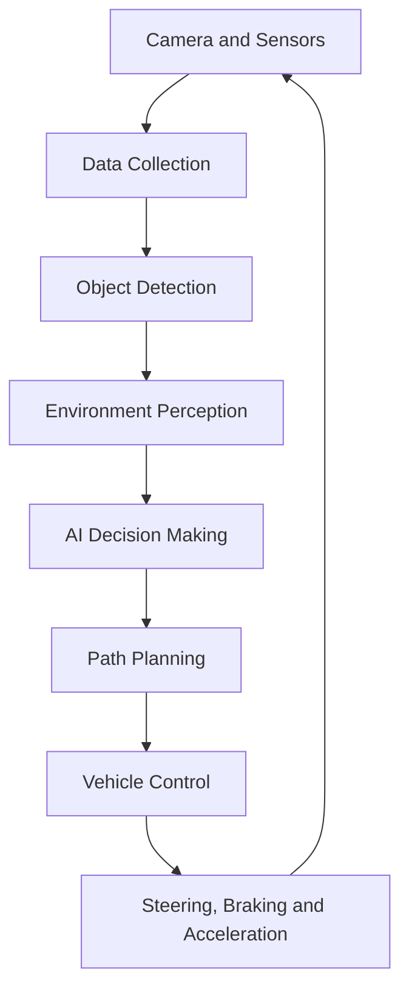

# Exploration-of-AI-Use-Case-Case-study-on-self-driving-cars
# AIM
To study the application of Artificial Intelligence (AI) in self-driving cars and understand how AI technologies help vehicles perceive their surroundings, make decisions, and navigate safely without continuous human control.
# THEORY

Self-driving cars, also known as autonomous vehicles, are vehicles that use Artificial Intelligence to operate without continuous human assistance. They use advanced technologies such as Machine Learning, Computer Vision, sensors, cameras, RADAR, LiDAR, and GPS to detect objects, recognize traffic signals, identify road conditions, and make driving decisions.

AI helps autonomous vehicles analyze real-time information from their surroundings and choose appropriate actions such as accelerating, braking, changing lanes, and avoiding obstacles.

**Examples of Self-Driving Car Technologies:**

1. **Computer Vision:** Identifies roads, vehicles, pedestrians, traffic signs, and signals using cameras.
2. **Machine Learning:** Helps vehicles learn from driving data and improve decision-making.
3. **LiDAR:** Uses laser pulses to measure distances and create a 3D map of the surroundings.
4. **RADAR:** Detects the distance and speed of nearby vehicles and objects.
5. **GPS and Navigation:** Determines the vehicle's location and plans the route.
6. **Sensor Fusion:** Combines information from different sensors to improve accuracy and safety.

**Examples of Self-Driving Cars:**
- Tesla Autopilot
- Waymo Driver
- Mercedes-Benz DRIVE PILOT
- Google Self-Driving Car Project

## WORKING PRINCIPLE

The working principle of self-driving cars involves the following steps:

1. **Data Collection:** Cameras, LiDAR, RADAR, and other sensors collect information about the surroundings.
2. **Object Detection:** Computer Vision identifies pedestrians, vehicles, traffic signs, and obstacles.
3. **Environment Perception:** AI processes sensor data to understand road conditions and surrounding objects.
4. **Decision Making:** Machine Learning algorithms analyze the situation and decide the appropriate driving action.
5. **Path Planning:** The system selects a safe route and determines the vehicle's movement.
6. **Vehicle Control:** The control system operates the steering, accelerator, and braking mechanisms.
7. **Continuous Monitoring:** Sensors continuously monitor the surroundings and update driving decisions.

### Working Flowchart

**Example:**

When a pedestrian crosses the road, the self-driving car detects the pedestrian using cameras and sensors. The AI system analyzes the situation, calculates the distance, and automatically applies the brakes to avoid an accident.

# RESULT
Thus, the application of Artificial Intelligence in self-driving cars was studied successfully. The roles of Machine Learning, Computer Vision, LiDAR, RADAR, GPS, and Sensor Fusion in autonomous driving were understood. The working principle of AI-based autonomous vehicles and their applications in improving road safety and driving efficiency were explored successfully.
